<p align="center">
  
</p>

<p align="center">
  <a href="https://leetcode.com/u/Panda_Singh/"></a>
  
  
  
  
</p>

<p align="center">
  
</p>


<p align="center">
  
</p>


## `01` ▸ OVERVIEW

A **daily problem-solving log** for Data Engineering interviews. Every problem is solved twice: once in **SQL**, once in **Pandas**.

```diff
+ SQL      →  joins · window functions · CTEs · ranking · pivots
+ Pandas   →  one Jupyter notebook per problem, one cell per approach
```

**Sources:** LeetCode Premium · DataLemur · StrataScratch · Ankit Bansal (real company case studies)

## `02` ▸ REPO MAP

```
TOPIC/
 ├── SQL/     →  Easy/  Medium/  Hard/     *.sql    (schema + data + -- m1, -- m2 …)
 └── PANDAS/  →  Easy/  Medium/  Hard/     *.ipynb  (statement · setup · # m1, # m2 …)
```

| Layer | Modules |
|---|---|
| **Core** | `CASE WHEN` · `DATE_TIME` · `FRIENDSHIP` · `GROUPBY` · `MISC` · `PIVOT` · `RECURSIVE_CTE` · `STRING` · `UNION` · `UNPIVOT` · `WHERE` |
| **JOIN** | `INNER` · `LEFT` · `CROSS` · `FULL-OUTER-JOIN` · `NON-EQUI` · `CAPACITY_VS_CUM_COUNT` |
| **WINDOW_FUNCTION** | `LAG_LEAD` · `RANKING` · `SUM` · `MAXIMUM` · `AVERAGE` · `CONTINUOUS_FINDING` |
| **ANKIT_BANSAL** | `sql/` · `pandas/` |

## `03` ▸ SKILL MATRIX

| Module | Capability |
|---|---|
| **CASE WHEN** | Conditional logic, CASE inside aggregations |
| **DATE_TIME** | Date arithmetic, formatting, intervals |
| **FRIENDSHIP** | Self-joins, mutual relationships, graph-style queries |
| **GROUPBY** | Aggregations, HAVING, multi-level grouping |
| **JOIN** | INNER · LEFT · CROSS · FULL OUTER · NON-EQUI · capacity vs cumulative |
| **MISC** | Mixed patterns, combined techniques |
| **PIVOT / UNPIVOT** | Rows ⇄ columns, conditional aggregation, normalization |
| **RECURSIVE_CTE** | Hierarchy traversal, sequence generation |
| **STRING** | Pattern matching, LIKE, REGEXP, string functions |
| **UNION** | UNION · UNION ALL · set operations |
| **WHERE** | Filtering, subqueries, correlated filters |
| **WINDOW_FUNCTION** | LAG/LEAD · RANK · DENSE_RANK · ROW_NUMBER · running sums · gaps & islands |
| **ANKIT_BANSAL** | Real company problems: Blinkit, Naukri, LinkedIn, Vyapar |


## `04` ▸ LEETCODE TELEMETRY

<p align="center">
  <a href="https://leetcode.com/u/Panda_Singh/">
    
  </a>
</p>

## `05` ▸ FIELD MISSIONS — ANKIT BANSAL

Company-level SQL case studies from real data interviews:

| Mission | Domain |
|---|---|
| 🛒 **Blinkit** | Delivery analytics |
| 💼 **Naukri** | Job platform queries |
| 🔗 **LinkedIn** | Social graph SQL |
| 📊 **Vyapar** | Business reporting |
| 💸 **More** | Revenue leakage · comeback customers · ticket escalation · shift handover · silent best sellers |

## `06` ▸ PROTOCOL

```
[ SOLVE ]  →  [ OPTIMIZE ]  →  [ DOCUMENT ]  →  [ COMMIT ]
```

- **Clarity, efficiency, scalability** in every solution
- Each module climbs `Easy` → `Medium` → `Hard`
- **SQL and Pandas outputs match** row for row
- Multiple approaches per problem (`m1`, `m2` …), e.g. LAG/DATEDIFF vs gaps-and-islands

## `07` ▸ MISSION LOG

```
📘  Structured learning archive
💼  Portfolio for recruiters
🔗  Public consistency tracker
🏆  leetcode.com/u/Panda_Singh
```

<p align="center">
  
</p>
